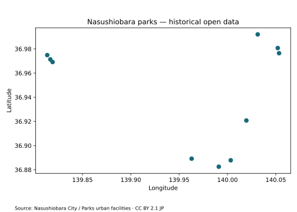

# Rhinestone Showcase

日本の公開データを探して、手元のPythonで開く。実行契約だけを別の環境へ渡す。

```python
results = search(text="公園", providers=[ProviderId.SEARCH_CKAN_JP],
                 format=(FormatPreset.PYOGRIO,), limit=3)
resource = next(r for r in results if r.uri == SELECTED_URI)
frame = resource.open("pyogrio", runtime=pyogrio)
```

那須塩原市の公園GeoJSONでは **10地点、EPSG:4979** を読み込み、下の図を生成しました。
Notebookでは候補を一覧表示してURIを明示選択し、0件・診断・選択不一致を案内します。



## 試す順序

| Notebook | 体験 | Colab |
| --- | --- | --- |
| [01 Discover](01_discover.ipynb) | KEYWORD / AREAを変え、タイトル・作成者・形式・配布URIを見る | [開く](https://colab.research.google.com/github/u-kitazawa/rhinestone/blob/develop/showcase/01_discover.ipynb) |
| [02 Open](02_open_vector.ipynb) | 候補を明示選択し、pyogrioで開いて地図を描き、Plan JSONを書き出す | [開く](https://colab.research.google.com/github/u-kitazawa/rhinestone/blob/develop/showcase/02_open_vector.ipynb) |
| [03 Portable](03_portable_vector.ipynb) | 02のJSONをアップロードし、検索元Providerのない環境で同じデータを開く | [開く](https://colab.research.google.com/github/u-kitazawa/rhinestone/blob/develop/showcase/03_portable_vector.ipynb) |
| [04 Explore](04_explore.ipynb) | 名前の条件を「八汐」「黒磯」等へ変え、公園を絞って強調表示する | [開く](https://colab.research.google.com/github/u-kitazawa/rhinestone/blob/develop/showcase/04_explore.ipynb) |
| [05 Raster](05_open_raster.ipynb) | 組み込みJAXA Providerで月降水量を検索し、日本周辺だけを縮小読取して表示する | [開く](https://colab.research.google.com/github/u-kitazawa/rhinestone/blob/develop/showcase/05_open_raster.ipynb) |

Colabでは **「ランタイム → すべてのセルを実行」** で先頭から実行してください。
個別に実行する場合は、setupセルに続いてimport・入力設定セルを実行し、その後に検索・読込セルへ進みます。
ランタイムを再起動した場合も先頭から実行します。認証キーは不要です。
01はCSVなども含めて形式を限定せずに探します。02はpyogrio対応形式で検索し直すため、
候補が異なります。SELECTED_URIは02で表示した一覧から選んでください。
01はRhinestoneだけ、02〜04は固定バージョンのpyogrio・GeoPandas・Matplotlibを導入します。
01〜04の固定コミットは `9bae025b08357d23e5f5339c25a777a1445da176` です。
05は組み込みJAXA Providerを含む `114a7a10c30880dfb1655d0ce94fb2bf0f917145` を使います。

02と03は別Notebook・新しいkernelで実行します。02の`vector-plan.json`をダウンロードし、
03の作業ディレクトリへアップロードしてください。既存ファイルは上書きしません。

```python
received_plan = AccessPlan.from_dict(json.loads(Path("vector-plan.json").read_text()))
frame = receiving_app.open(received_plan, "pyogrio", runtime=pyogrio)
```

受信側は既知の配布URIをdirect Providerで明示的に許可します。
検索APIへ再問い合わせせずに実行できますが、実データの配布URLへの通信は発生します。
Planにデータ本体・Runtime・Credentialは入りません。外部データが更新されれば結果も変わります。

## データと再現性

出典：那須塩原市 建設部 保全管理課「公園 都市整備施設」（【那須塩原市】公園 都市整備）。
[元リソース](https://opendata-nasu.opendatastack.jp/dataset/shisetu-kouenn-tosisetibi/resource/d94a1299-e0fb-4c9a-9a9f-aac7dcb97763) ·
[配布GeoJSON](https://nasu-ckan.s3.amazonaws.com/ckan/resources/d94a1299-e0fb-4c9a-9a9f-aac7dcb97763/011201.json) ·
[利用規約](https://opendata-nasu.opendatastack.jp/pages/userpolicy) ·
[CC BY 2.1 JP](https://creativecommons.org/licenses/by/2.1/jp/)。

2026-10-20の確認時は7,243 bytes。提供元の最終更新表示は2016-04-04です。
最新の施設一覧・営業状況・位置の精度は保証されません。名称と位置を抽出し、表示用にEPSG:4326へ変換しています。
写真・外部画像・背景タイルは取得しません。描画や絞り込みはGeoPandas/Matplotlibが担います。

検索はmetadata取得で、Openはデータ本体取得です。地域指定はファイル中の地物を切り出しません。
`limit=3`はProviderごとのResource数であり、HTTP要求数や転送量の上限ではありません。
入力・選択先を変えるときは形式・容量・利用条件を確認してください。複数Providerの順序は共通の関連度ランキングではありません。
0件、提供元の障害、読込失敗はNotebookの案内とdiagnosticsを確認できます。

保存出力は実Pythonセルを独立したプロセスで実行して得た観測です。
Colabでの実行は、01〜04が2026-10-24、05が2026-10-31にユーザーから成功報告を受けています。
05では準備セル未実行による`search`未定義を解消した後の成功報告です。
この記録はユーザー報告に基づき、保存出力の追加や他のJupyter環境での検証を意味しません。
ライブ Provider への疎通は通常 CI の必須条件にしません。fixtureで検証できる契約は通常CIで確認します。
保守者のlocal smokeでは`RHINESTONE_SHOWCASE_LOCAL=1`でsetupの再installを省略できます。
その場合は上記commitと依存を別途用意して検証対象を記録します。TLSが環境依存の場合は管理済みCAをGDALへ設定してください。

## ラスターと発展編

05は追加設定・APIキーなしで、JAXA Earth GSMaP月降水量の検証済みプレビューを検索します。
対象は2021年2月・level 0・東経0〜180度に固定された組み込みProviderです。JAXA全製品・全期間を
検索する例ではありません。検索はCatalogとItemの最大2文書に制限され、OpenではCOG全体を
メモリ展開せず、日本周辺を64×64へ縮小読取します。RasterioとMatplotlibは利用者側のRuntimeです。

JAXA Earth APIは静的COG/STACを配信し、現時点で登録・APIキー・回数制限を設けていません。
データごとのライセンスはSTACの情報を確認し、公開成果にはJAXA Earth APIを利用した旨を明記してください。
[公式サイトと利用条件](https://data.earth.jaxa.jp/ja/)を参照してください。

必要な場面で詳細を調べられるよう、内部の来歴と手入力STACは別の入口へ移しました。

- [発見側と解決側の来歴](advanced/discovery_lineage.ipynb) · [Colab](https://colab.research.google.com/github/u-kitazawa/rhinestone/blob/develop/showcase/advanced/discovery_lineage.ipynb)
- [既知のSTAC Item / assetを指定する](advanced/stac_explicit.ipynb) · [Colab](https://colab.research.google.com/github/u-kitazawa/rhinestone/blob/develop/showcase/advanced/stac_explicit.ipynb)

発展編の4項目手入力は、05の設定不要な入口とは別の高度な利用例です。

短いAPI例は[examples](../examples/README.md)、手順や内部契約は[利用者ガイド](../docs/getting-started.md)を参照してください。
NotebookのコードはMIT License、公開データには上記の配布元条件が適用されます。

